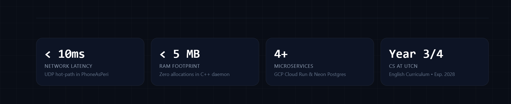
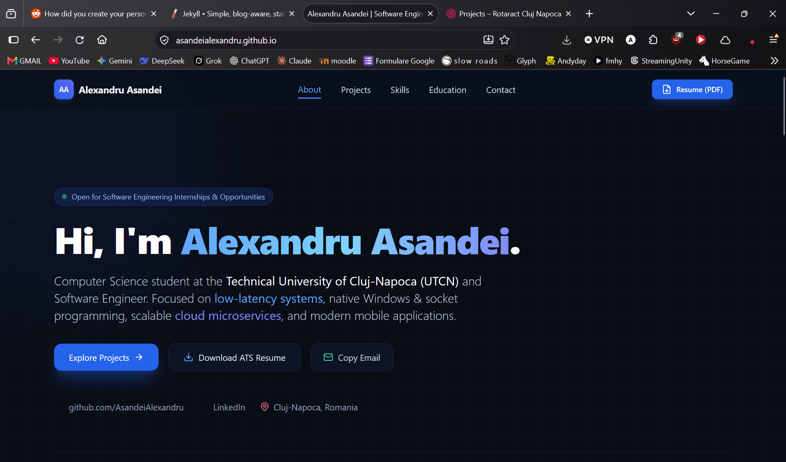

# Portfolio Website — Improvements & Updates Roadmap

This document tracks upcoming enhancements, content additions, and technical polish for [asandeialexandru.github.io](https://asandeialexandru.github.io).

---

## 📌 Priority 1: Visual Assets & Project Media

- [ ] **Remove this :**
- [ ] **Here make the next changes:**
  
  keep only this: Computer Science student at the Technical University of Cluj-Napoca (UTCN)
  remove this: Open for Software Engineering Internships & Opportunities
- [ ] **Professional Avatar / Headshot**:
  - Add a high-quality professional portrait in the Hero or About section next to the introduction.
- [X] **Project Screenshots / GIFs**:
  - **PhoneAsPeri**: Add a 5–10 second GIF or high-resolution screenshot of the Flutter mobile studio (virtual keyboard, joystick, air mouse) and Windows daemon console showing sub-10ms packet timings.
  - **LDD_FRS**: Add a screenshot of the football player analytics dashboard UI / PPI charts.
  - **Rentz Multiplayer**: Add a screenshot of the Java Swing game table during active tournament gameplay.
- [X] **Social Share Card (Open Graph Image)**:
  - Create a 1200x630 `og-image.png` so when the link `https://asandeialexandru.github.io` is shared on LinkedIn, WhatsApp, or Discord, a rich preview card appears.
- [ ]

---

## ⚡ Priority 2: Technical & Interactive Enhancements

- [ ] **Light / Dark Mode Toggle**:
  - The site currently defaults to a sleek dark glassmorphic theme. Add a toggle button in the navbar allowing recruiters to switch to a clean light theme if preferred.
- [X] **Project Deep-Dive Modals**:
  - Add a "View Architecture" button on project cards that opens a modal window with:
    - Packet structure diagram for PhoneAsPeri UDP protocol.
    - Microservice sequence diagram for LDD_FRS (Spring Boot $\leftrightarrow$ FastAPI $\leftrightarrow$ Neon Postgres).
- [ ] **Interactive Terminal / Command Preview**:
  - Add an interactive terminal widget in the hero section displaying quick commands (e.g. `alexandru.status`, `alexandru.skills`, `alexandru.contact`).

---

## 🌐 Priority 3: Custom Domain & Analytics

- [ ] **Custom Domain (Optional)**:
  - If desired, register a personalized domain (e.g. `alexandruasandei.dev` or `alexandruasandei.ro`).
  - Configure `CNAME` in GitHub Pages settings and DNS records.
- [ ] **Privacy-Friendly Analytics**:
  - Add lightweight, zero-cookie analytics (such as Cloudflare Web Analytics or Plausible) to see how many recruiters and visitors view your portfolio and download your resume.

---

## 🔄 Routine Sync Checklist (After CV Updates)

Whenever you update your resume or add new achievements:

1. Re-generate your resume via `CV_Files\build_cv.bat`.
2. Copy the updated `Alexandru_Asandei_CV.pdf` from `CV_Files\` into `PersonalSite\`.
3. Update project details or metrics in `PersonalSite\index.html` if new milestones or courses are completed.
4. Commit and push:
   ```bash
   git add .
   git commit -m "docs: sync updated resume PDF and metrics"
   git push origin main
   ```

---

## ✅ Completed Milestones

- [X] Initialized modern single-page portfolio layout with Tailwind CSS & Vanilla JS.
- [X] Configured native GitHub Pages repository (`asandeialexandru.github.io`).
- [X] Integrated engineering metric counters (<10ms latency, <5MB RAM, 4+ microservices, Year 3 @ UTCN).
- [X] Categorized project filtering (Systems & C++, Cloud & Backend, Mobile & Desktop).
- [X] Direct ATS resume PDF download integration.
- [X] Contact bar with copy-to-clipboard email notification and direct social links.
